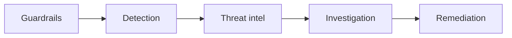
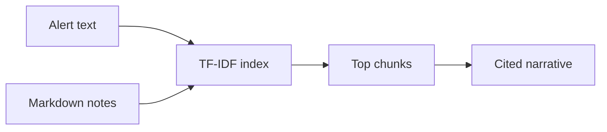
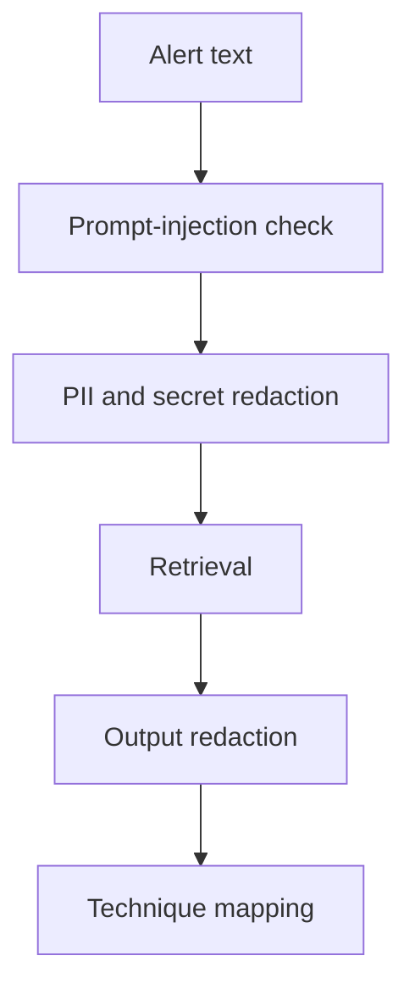
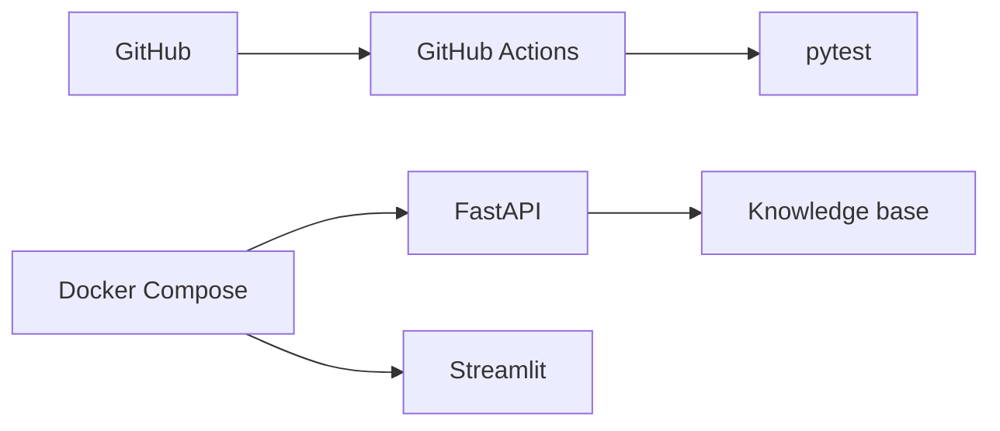

# AI Security Detection & Response Copilot

Local investigation copilot for SOC analysts. An alert goes through guardrails, a four-stage investigation graph, and a knowledge base the repo controls. The report cites what it retrieved and records which stage produced each claim.

[](https://www.python.org/)
[](https://fastapi.tiangolo.com/)
[](https://streamlit.io/)
[](LICENSE)

This is a reference implementation an engineer can run and defend. It is not a managed SOC product, and it does not claim a customer deployment.

## Executive summary

Analysts lose time when an alert is a pile of text and the next step lives in a wiki. This service accepts one alert, refuses it when the text tries to override the system, redacts tokens and email addresses, maps a few high-signal patterns to ATT&CK techniques, retrieves the matching notes, and returns containment steps plus a draft detection. Every stage writes an evidence line. If retrieval is weak, the report says so.

## Problem statement

A detection tool can raise an alert and still leave the analyst to remember the technique, the runbook, and which fields are safe to paste into a model. Pasting raw alerts into a chatbot mixes secrets, prompt injection, and unsourced advice. The missing product is a narrow pipeline: untrusted alert in, cited investigation out, with the refusal path tested.

## Business value

The value of this reference build is reviewability. A hiring team can clone it, run the tests, and see a refused injection, a redacted secret, and a phishing alert that cites `mitre-t1566.md`. The case for a real deployment would be analyst time and accepted recommendations, measured on that team's alerts. Those numbers are not invented here.

## Architecture overview

```mermaid
flowchart LR
    user[Analyst] --> ui[Streamlit UI]
    ui --> api[FastAPI]
    api --> graph[Investigation graph]
    graph --> gemini[Narrative path]
    graph --> kb[Knowledge base]
    kb --> mitre[ATT&CK notes]
    kb --> cisa[CISA note]
    kb --> nist[NIST note]
    graph --> report[Cited report]
```

The narrative path is deterministic in this build. `GEMINI_API_KEY` is reserved and unused. Details: [docs/architecture.md](docs/architecture.md).

## Key features

- `POST /investigate` accepts an alert and returns a structured report.
- Streamlit shows the narrative, containment list, citations, audit trail, and draft detection.
- Five recorded stages: guardrails, detection, threat intel, investigation, remediation.
- Knowledge base of technique cards, framework notes, and runbooks.
- Pytest covers refusal, redaction, the API, and retrieval recall.

## AI security features

- Prompt-injection phrases refuse the investigation before retrieval.
- Email addresses, national-identifier shapes, and common API-token prefixes are redacted on the way in and on the way out.
- Draft detections are marked `status: draft` so they are not treated as deployed rules.
- The API ships without authentication. That is called out in [docs/security-controls.md](docs/security-controls.md).

## Agentic features



Detection, threat intel, investigation, and remediation are the analyst stages. Guardrails wrap them. Each stage returns evidence, not a hidden trace. See [docs/agents.md](docs/agents.md).

## RAG features



Seven markdown documents. Scores under 0.08 are dropped. The phishing test requires `mitre-t1566.md` in the citations. A Chroma adapter is in `rag/retriever.py` for a later dense index. See [docs/rag-design.md](docs/rag-design.md).

## MITRE ATT&CK

The reference rules map terms to three techniques:

| Signal | Technique | Tactic |
| --- | --- | --- |
| Phishing, invoice, mailbox, attachment | T1566 | Initial Access |
| PowerShell, encoded command, cmd.exe | T1059 | Execution |
| Impossible travel, privileged, valid account | T1078 | Valid Accounts |

Unmapped alerts stay low severity. The notes are original summaries, not a copy of the ATT&CK site.

## Explainable AI

The report's `steps` list is the explanation: agent, one-line summary, and the terms or filenames it used. The narrative names the retrieved files. A wrong answer can be traced to a rule in `agents/graph.py` or a file in `knowledge_base/`.

## AI governance and guardrails



Controls live in `security/guardrails.py` so they can be read in one file. Presidio and Guardrails AI cover the same jobs with broader recognizers. They are not imported here. Swap them in behind the same two functions if you need that coverage.

## Security controls

- Alerts are untrusted content.
- Injection text does not reach retrieval.
- Secrets do not appear in the narrative.
- Containment actions come from a fixed map, not from free-form generation.
- No production log source is wired in.

## Deployment architecture



```powershell
docker compose up --build
```

The API is on port 8000 and the UI is on port 8501. The UI container sets `COPILOT_API_URL` so it calls the API. See [docs/deployment.md](docs/deployment.md).

## Installation

```powershell
cd $HOME\ai-security-copilot
python -m venv .venv
.\.venv\Scripts\Activate.ps1
pip install -r requirements.txt
copy .env.example .env
```

## Docker

```powershell
docker build -t security-copilot .
docker run --rm -p 8000:8000 -e HOST=0.0.0.0 security-copilot
```

## Local development

API:

```powershell
python -m backend.main
```

UI, in a second terminal, from the repo root:

```powershell
streamlit run frontend/app.py
```

`POST http://127.0.0.1:8000/investigate` with `{"alert":"..."}`.

Example alert:

```text
Mailbox alert: invoice attachment from a new sender domain. User reported a phishing message.
```

## Testing

```powershell
pytest -q
```

The suite checks health, a T1078 investigation, injection refusal, secret redaction, the agent order, and recall of the expected note in the top 3 for five questions.

## CI

`.github/workflows/test.yml` installs dependencies and runs `pytest` on Ubuntu with Python 3.12. Publishing that file requires a GitHub token with the `workflow` scope.

## Future roadmap

More techniques, a measured Chroma comparison, a Gemini narrative that cannot cite a file it did not retrieve, authentication, and an analyst accept or reject label. The full list is [docs/roadmap.md](docs/roadmap.md). None of those items are described as finished.

## Why this project stands out

It is a small system with the control planes security teams actually ask about.

- **AI security.** The alert is treated as hostile input, and the refusal is tested.
- **Agentic workflow.** Four analyst stages plus guardrails, each with evidence.
- **RAG.** Answers point at files in the repo, and a miss abstains.
- **Security engineering.** Redaction and draft-only detections are code, not a slide.
- **Detection engineering.** Technique mapping and a Sigma-style draft stay in review status.
- **Threat hunting.** Retrieval is the hunt across the notes, not a claim about a customer tenant.
- **Incident response.** Containment follows the NIST analysis and containment phases and stays with the analyst.
- **Explainable output.** The audit trail is the product, not an appendix.
- **Governance.** The model path is off by default, so the system cannot improvise a new action.

## Hiring manager highlights

- The happy path, the refusal, and the redaction are tests, not a demo script.
- The README matches the code. Gemini, Chroma, Presidio, Guardrails AI, and LangGraph are named only where they are an adapter or a documented next step.
- A reviewer can read `agents/graph.py` and `security/guardrails.py` in one sitting.
- The corpus is small on purpose. Quality is the recall check, not a count of files.
- There is a written statement that the API has no authentication and must not receive production alerts as-is.

## Resume bullets

Use these only because they describe this repository. Add a measured analyst outcome after you have one. Do not invent it.

1. Built a local SOC investigation copilot that takes one alert through guardrails, technique mapping, retrieval, a cited narrative, and containment steps.
2. Refused investigations when alert text matched prompt-injection patterns, and kept retrieval from running on that path.
3. Redacted email addresses and token-shaped secrets before they could appear in the analyst narrative.
4. Mapped phishing, script execution, and valid-account signals to T1566, T1059, and T1078, and left unmapped alerts at low severity.
5. Retrieved technique notes and runbooks with TF-IDF and dropped chunks under a 0.08 score.
6. Required a phishing alert to cite `mitre-t1566.md`, and checked five questions for the expected note in the top 3.
7. Recorded an audit step for guardrails, detection, threat intel, investigation, and remediation, including the evidence each stage used.
8. Emitted Sigma-style detection drafts marked `status: draft` so they stay in analyst review.
9. Served the report from FastAPI and a dark Streamlit UI, with Docker Compose for the API and the UI.
10. Documented the missing production controls: authentication, a tenant filter, and a measured dense-retriever comparison.

## Technical challenges

- **Alerts are prompts.** The investigation had to stop before retrieval when the alert tried to override instructions.
- **Secrets in the case text.** Redaction has to run on the input that the narrative quotes, not only on a side log.
- **Unsourced advice.** The narrative is assembled from retrieved titles and a fixed action map so a missing chunk is visible.
- **Dependency theater.** A demo that only runs with five paid services cannot be reviewed. The core path is offline. Adapters are optional.
- **Draft detections.** A generated rule that looks deployable is a hazard. The draft is labeled and the service does not ship it to a SIEM.

## Lessons learned

- Name the libraries you import. Name the others as next steps.
- An audit trail of filenames is more useful in an interview than a paragraph about explainability.
- A seven-document corpus with a failing test on a miss is a better story than a large unscored index.
- Containment text should be boring and fixed. Creativity belongs in the retrieval, not in the action.

## Interview talking points

1. The alert is untrusted content, the same way a retrieved web page is untrusted content.
2. Injection checks run before retrieval so a hostile alert cannot steer which document is fetched.
3. Refusal is a product outcome. The API returns `status: refused` and an empty citation list.
4. Redaction is applied to the string the narrative quotes, then applied again to the finished text.
5. Token detection is prefix-based and will miss novel secret formats. That is a stated limit.
6. Technique mapping is a keyword table. It will false-positive on the word "invoice" in a benign alert. The analyst still owns the disposition.
7. Severity is the max of the matched techniques, not a model score.
8. Unmapped alerts do not get a guessed technique.
9. TF-IDF is the default because technique IDs and command names are exact.
10. The abstain threshold is 0.08 cosine. Below that, the narrative says the knowledge base did not hit.
11. Recall is checked on five questions. A corpus edit that breaks a question fails pytest.
12. Citations are the filenames of hits, not generated titles.
13. The Chroma class is real code and it is not on the default path. Tests do not import it.
14. Gemini is not called. A later narrative model would be forbidden from naming a source that was not in the hit list.
15. LangGraph is the natural runner for these stages because each stage is already state in, state out. It is not a dependency of the tests.
16. Containment actions are a dictionary keyed by technique ID.
17. The detection draft is Sigma-shaped YAML and marked draft. Nothing pushes it to a SIEM.
18. NIST shows up as the phase model: this service helps analysis and recommends containment. It does not eradicate or recover.
19. The CISA note tells the analyst to treat a CVE match as enrichment, not proof.
20. The API has no auth. The deployment doc says not to send production alerts until that exists.

## Repository guide

| Path | Role |
| --- | --- |
| `frontend/app.py` | Streamlit case view |
| `backend/api.py` | FastAPI `/health` and `/investigate` |
| `agents/graph.py` | Investigation stages |
| `rag/retriever.py` | TF-IDF index and optional Chroma adapter |
| `security/guardrails.py` | Injection checks and redaction |
| `knowledge_base/` | Technique cards, framework notes, runbooks |
| `tests/` | Refusal, redaction, API, recall |
| `docs/` | Architecture, controls, RAG, agents, deployment, roadmap |
| `docs/images/README.md` | Screenshot filenames and image prompts |
| `Dockerfile`, `docker-compose.yml` | API and UI processes |

## GitHub listing

**Description:** Local SOC investigation copilot with guardrails, cited retrieval, ATT&CK mapping, and an audit trail.

**Topics:** `ai-security`, `soc`, `detection-engineering`, `incident-response`, `rag`, `fastapi`, `streamlit`, `mitre-attack`, `guardrails`, `python`

**Versioning:** Semantic versions. `0.1.0` is this reference build. A minor version adds a technique family or a retriever. A major version is the one that adds authentication and a real alert source.

**Milestones:**

1. Reference build: offline graph, tests, docs.
2. Dense retriever compared with TF-IDF on a paraphrased question set.
3. Authenticated API and an analyst feedback file.

## License

MIT. See [LICENSE](LICENSE).
